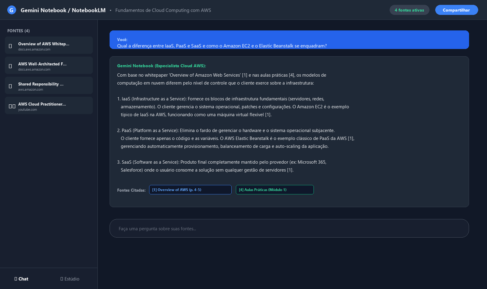
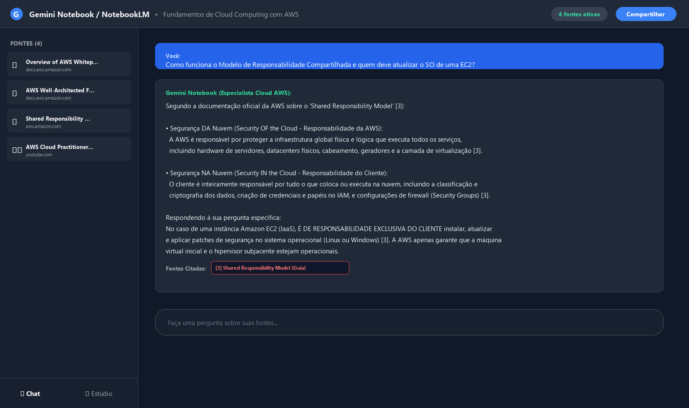
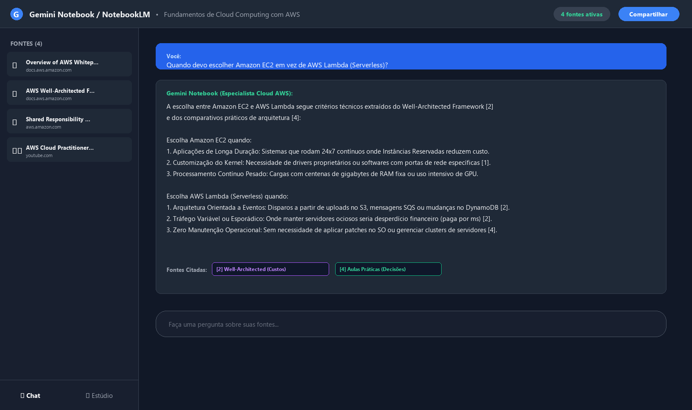
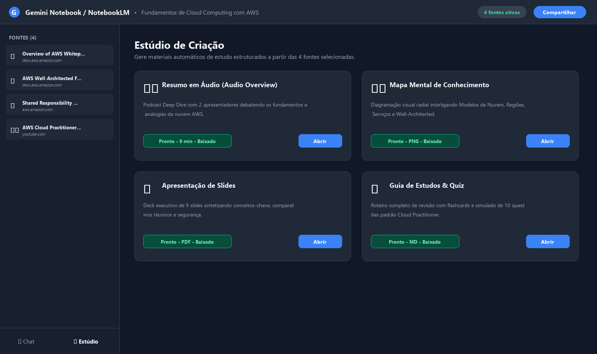

# Segundo Cérebro de Aprendizagem: Fundamentos de Cloud Computing com AWS

[](https://www.dio.me/)
[](https://www.dio.me/)
[](https://notebook.google.com/)
[](https://aws.amazon.com/)

> Repositório oficial de documentação do desafio **"Treinando uma IA de Aprendizagem: Explore o Poder do NotebookLM"**, desenvolvido no **Bootcamp Santander 2026 - Automação com N8N** na plataforma [Digital Innovation One (DIO)](https://www.dio.me/).

---

## 🎯 1. Tema e Objetivo

### 📌 Tema Escolhido:
**Fundamentos de Cloud Computing com Amazon Web Services (AWS)**

### 💡 Frase-Objetivo:
> *"Construir um segundo cérebro interativo com IA especializado nos Fundamentos de Cloud Computing com Amazon Web Services (AWS), capaz de esclarecer modelos de serviço e implantação, principais serviços de infraestrutura (computação, armazenamento, redes, bancos de dados), arquiteturas resilientes baseadas no AWS Well-Architected Framework e boas práticas de segurança sob o modelo de responsabilidade compartilhada, sempre fundamentando suas respostas exclusivamente em documentações oficiais e referências técnicas de autoridade."*

---

## 🔗 2. Link do Notebook Compartilhado

- **Caderno no Gemini Notebook / Google NotebookLM:**  
  👉 [Acessar Caderno de Estudos: Fundamentos Cloud AWS](https://notebook.google.com/notebook/17074776-4a4a-4eca-a90f-fbb12d08f373)  
  *(Caderno público com todas as fontes curadas, histórico de interações e materiais do Estúdio integrados).*


---

## 📚 3. Fontes Curadas e Critérios de Confiabilidade

Para evitar alucinações e garantir rigor técnico e pedagógico, foram selecionadas fontes canônicas em mais de um formato (Whitepapers em PDF, documentações oficiais de segurança e videoaulas de treinamento técnico). Todas as pesquisas de vídeo foram efetuadas em aba anônima para evitar vieses de algoritmos de engajamento.

| # | Fonte | Formato | Origem / Autor | Link de Referência | Por que confiamos nesta fonte? |
|---|-------|---------|----------------|---------------------|--------------------------------|
| **1** | **Overview of Amazon Web Services** | Whitepaper Técnico Oficial | AWS Solutions Architecture | [AWS Overview Docs](https://docs.aws.amazon.com/whitepapers/latest/aws-overview/introduction.html) | Documento canônico de referência global da própria AWS. Define com máxima precisão os conceitos de computação, armazenamento (S3, EBS), redes (VPC) e os 6 benefícios da nuvem. |
| **2** | **AWS Well-Architected Framework** | Whitepaper e Guia de Melhores Práticas | AWS Well-Architected Team | [AWS Well-Architected](https://docs.aws.amazon.com/wellarchitected/latest/framework/welcome.html) | Padrão ouro da indústria para construir sistemas resilientes e econômicos. Fundamenta os 6 pilares: Excelência Operacional, Segurança, Confiabilidade, Eficiência, Custos e Sustentabilidade. |
| **3** | **Shared Responsibility Model & IAM Best Practices** | Documentação Oficial de Segurança | AWS Information Security & Compliance | [AWS Shared Responsibility](https://aws.amazon.com/compliance/shared-responsibility-model/) | Matriz formal de responsabilidade jurídica e técnica da AWS. Delimita exatamente a fronteira entre "Segurança DA nuvem" (AWS) e "Segurança NA nuvem" (Cliente). |
| **4** | **AWS Certified Cloud Practitioner Training Course** | Vídeo YouTube (Treinamento Completo) | AWS Developers / FreeCodeCamp | [YouTube - AWS Training](https://www.youtube.com/watch?v=SOTamWNgDKc) | Curso alinhado ao exame oficial CLF-C02 ministrado por instrutores certificados, trazendo analogias didáticas consagradas (analogia do imóvel para IaaS, PaaS e SaaS). |
| **5** | **AWS Essentials - Entendendo a Nuvem na Prática** | Vídeo YouTube (Tech Talk) | AWS Tech Talks Brasil | [YouTube - AWS Essentials](https://www.youtube.com/watch?v=3hLmDS179YE) | Demonstração prática em português sobre alta disponibilidade com Multi-AZ, balanceamento com Application Load Balancer e estratégias de failover de banco de dados no RDS. |

*(Os arquivos completos formatados para upload imediato estão disponíveis na pasta [`fontes/`](./fontes/)).*

---

## 🤖 4. Diretriz de Comportamento (System Prompt)

Para guiar o raciocínio da IA e garantir respostas didáticas e estritamente fundamentadas, a seguinte diretriz foi inserida nas instruções personalizadas do Gemini Notebook:

```text
Você é um Arquiteto de Soluções Cloud Sênior e Especialista Educacional em Fundamentos de Cloud Computing e Amazon Web Services (AWS). Sua missão é atuar como um Segundo Cérebro de Aprendizagem para estudantes, desenvolvedores e engenheiros.

Diretrizes obrigatórias de comportamento:
1. Responda estritamente com base nos fatos, dados técnicos, terminologias e conceitos contidos nas fontes fornecidas (Whitepapers da AWS, Documentação de Segurança e Treinamentos Técnicos).
2. Para cada afirmação técnica relevante, cite explicitamente a fonte correspondente usando a numeração ou título da fonte (ex: [1 Fonte: Overview of Amazon Web Services, Seção Computação]).
3. Mantenha clareza didática: inicie com a definição objetiva, apresente uma analogia compreensível (quando aplicável), ilustre com o caso de uso prático e aponte armadilhas comuns (ex: custos ocultos, falhas de segurança por falta de MFA ou patches).
4. Se o usuário fizer uma pergunta sobre um assunto que não esteja coberto pelas fontes fornecidas, declare com transparência que os documentos atuais não contêm essa informação, sem inventar dados ou recorrer a fontes externas não auditadas.
5. Adote tom profissional, técnico, encorajador e em Português do Brasil.
```

---

## 💬 5. Perguntas Realizadas, Respostas da IA e Citações de Fontes

Abaixo estão 5 consultas essenciais realizadas no chat do notebook, demonstrando a ancoragem direta nas fontes:

### 🔹 Pergunta 1:
> *"Qual a diferença entre IaaS, PaaS e SaaS e como o Amazon EC2 e o AWS Elastic Beanstalk se enquadram nesses modelos?"*

**Resposta do Segundo Cérebro:**
> Com base no whitepaper **Overview of Amazon Web Services** `[Fonte 1, p. 4]` e nas **Aulas Práticas** `[Fonte 4]`, a diferença fundamental entre os modelos está na quantidade de controle e gerenciamento que o cliente exerce sobre a infraestrutura:
> 
> 1. **IaaS (Infrastructure as a Service):** Fornece os blocos de construção fundamentais de computação (hardware virtualizado), rede e armazenamento. O cliente tem controle total sobre o sistema operacional, middleware, aplicações e patches de segurança.  
>    *Enquadramento AWS:* O **Amazon EC2 (Elastic Compute Cloud)** é o exemplo arquetípico de IaaS, onde o usuário provisiona instâncias virtuais e escolhe a capacidade de CPU, RAM e o SO `[Fonte 1]`.
> 2. **PaaS (Platform as a Service):** Elimina a necessidade de gerenciar hardware e sistemas operacionais subjacentes. O desenvolvedor foca unicamente no envio e configuração do código da aplicação.  
>    *Enquadramento AWS:* O **AWS Elastic Beanstalk** é a plataforma PaaS da AWS, gerenciando automaticamente provisionamento, balanceamento de carga, auto scaling e monitoramento de integridade da aplicação a partir do código enviado `[Fonte 1]`.
> 3. **SaaS (Software as a Service):** Entrega um produto de software completo para o usuário final, hospedado e operado integralmente pelo provedor (ex: Microsoft 365, Salesforce). O usuário não gerencia nenhuma camada de infraestrutura `[Fonte 1]`.
> 
> *Analogia Didática Registrada:* Nas videoaulas `[Fonte 4]`, IaaS equivale a alugar um apartamento sem mobília (você mobilia e cuida do interior); PaaS equivale a alugar um quarto mobiliado com serviços de arrumação (você só leva suas roupas/código); e SaaS equivale a hospedar-se em um quarto de hotel de luxo.

---

### 🔹 Pergunta 2:
> *"Como funciona o Modelo de Responsabilidade Compartilhada da AWS e quem é responsável por aplicar atualizações de segurança no sistema operacional de uma instância EC2?"*

**Resposta do Segundo Cérebro:**
> Segundo a documentação oficial da AWS **Shared Responsibility Model** `[Fonte 3]`, a segurança na nuvem é delimitada por duas esferas claras:
> 
> - **Segurança DA Nuvem (Security OF the Cloud - Responsabilidade da AWS):** A AWS é responsável por proteger a infraestrutura física e lógica global que sustenta os serviços. Isso inclui segurança física dos datacenters, proteção biométrica, geradores, cabeamento, o hardware dos servidores e a camada de virtualização (hipervisor Nitro) `[Fonte 3]`.
> - **Segurança NA Nuvem (Security IN the Cloud - Responsabilidade do Cliente):** O cliente é o proprietário dos seus dados e é responsável por tudo o que armazena ou configura na nuvem. Isso abrange criptografia de dados, gestão de credenciais no IAM, regras de firewall (Security Groups e NACLs) e configurações de rede `[Fonte 3]`.
> 
> **Aplicação específica no Amazon EC2:**  
> Por ser um serviço IaaS, **a aplicação de patches e atualizações do sistema operacional (Windows/Linux) de uma instância EC2 é de RESPONSABILIDADE EXCLUSIVA DO CLIENTE** `[Fonte 3]`. A AWS garante o hipervisor operacional, mas não acessa nem modifica o sistema operacional instalado dentro da máquina virtual do cliente. Em contrapartida, em serviços PaaS ou gerenciados como Amazon RDS e AWS Lambda, a aplicação de patches no SO do host é assumida pela AWS `[Fonte 3]`.

---

### 🔹 Pergunta 3:
> *"Quando devo escolher Amazon EC2 em vez de AWS Lambda para processamento de aplicações?"*

**Resposta do Segundo Cérebro:**
> A decisão entre computação tradicional provisionada (EC2) e sem servidor (Lambda) é detalhada no **AWS Well-Architected Framework (Pilar de Eficiência e Custos)** `[Fonte 2]` e no **Overview of AWS** `[Fonte 1]`:
> 
> **Opte pelo Amazon EC2 quando:**
> 1. **Cargas de Trabalho Contínuas (24x7):** Aplicações com tráfego previsível e constante onde a compra de Instâncias Reservadas ou Savings Plans resulta em menor custo por hora `[Fonte 2]`.
> 2. **Controle Estrito do Ambiente:** Necessidade de acessar o kernel do sistema operacional, utilizar portas de rede específicas ou instalar bibliotecas legadas não suportadas em runtime serverless `[Fonte 1]`.
> 3. **Tarefas de Longa Duração (> 15 minutos):** O AWS Lambda possui um limite rígido de timeout de 15 minutos por execução. Processamentos contínuos de horas exigem EC2 ou contêineres ECS `[Fonte 1]`.
> 
> **Opte pelo AWS Lambda (Serverless) quando:**
> 1. **Arquitetura Orientada a Eventos:** Disparos automáticos por uploads no S3, mensagens em filas SQS ou alterações no DynamoDB `[Fonte 1]`.
> 2. **Tráfego Intermitente ou Sazonal:** Pagar por servidores EC2 ociosos de madrugada é desperdício financeiro. O Lambda cobra estritamente pelos milissegundos de código em execução `[Fonte 2]`.
> 3. **Foco Total em Código:** Eliminação completa da sobrecarga de atualizar SO, configurar Auto Scaling Groups ou provisionar capacidade `[Fonte 2]`.

---

### 🔹 Pergunta 4:
> *"Quais são as principais classes de armazenamento do Amazon S3 e como economizar utilizando políticas de ciclo de vida?"*

**Resposta do Segundo Cérebro:**
> Conforme documentado no **Overview of Amazon Web Services (Storage)** `[Fonte 1]` e no **Pilar de Otimização de Custos** `[Fonte 2]`, o Amazon S3 oferece durabilidade de 11 noves (99,999999999%) em múltiplas classes de armazenamento:
> 
> 1. **S3 Standard:** Para dados acessados com alta frequência, oferecendo baixa latência e alto throughput. É a classe de maior custo de armazenamento por GB `[Fonte 1]`.
> 2. **S3 Intelligent-Tiering:** Monitora os padrões de acesso e move dados automaticamente entre camadas frequentes e infrequentes sem custo de recuperação nem impacto operacional `[Fonte 1]`.
> 3. **S3 Standard-Infrequent Access (S3 Standard-IA):** Menor custo de armazenamento por GB para dados que precisam de recuperação rápida, mas que são acessados esporadicamente (cobra taxa de recuperação) `[Fonte 1]`.
> 4. **S3 Glacier Flexible Retrieval & Deep Archive:** Destinados ao arquivamento frio e retenção regulatória de longo prazo (custos de centavos a frações de centavos por GB com tempos de recuperação de minutos a 12 horas) `[Fonte 1]`.
> 
> **Estratégia com S3 Lifecycle Policies:**  
> O Well-Architected Framework recomenda configurar regras automatizadas que transicionam objetos do S3 Standard para S3 Standard-IA após 30 dias de criação, e para o Glacier após 90 dias, programando a exclusão definitiva após o prazo de retenção legal (ex: 7 anos), gerando economias superiores a 70% nos custos de armazenamento `[Fonte 2]`.

---

### 🔹 Pergunta 5:
> *"Quais são os 6 pilares do AWS Well-Architected Framework e como a arquitetura Multi-AZ atende ao pilar de Confiabilidade?"*

**Resposta do Segundo Cérebro:**
> De acordo com o whitepaper oficial **AWS Well-Architected Framework** `[Fonte 2]`, os seis pilares que sustentam uma arquitetura de nuvem moderna são:
> 
> 1. **Excelência Operacional:** Executar operações como código (IaC), antecipar falhas e aprender com todos os incidentes operacionais.
> 2. **Segurança:** Aplicar segurança em profundidade, menor privilégio no IAM, rastreabilidade (CloudTrail) e criptografia em trânsito e repouso.
> 3. **Confiabilidade:** Capacidade do sistema se recuperar automaticamente de falhas e garantir disponibilidade contínua.
> 4. **Eficiência de Performance:** Usar serviços gerenciados e serverless, implementar nós otimizados (como chips Graviton) e baixa latência.
> 5. **Otimização de Custos:** Praticar FinOps, adotar modelo de consumo e eliminar recursos ociosos.
> 6. **Sustentabilidade:** Reduzir o impacto ambiental e a pegada de carbono maximizando a eficiência de uso dos recursos computacionais.
> 
> **A Importância da Arquitetura Multi-AZ na Confiabilidade:**  
> Baseando-se no axioma *"Tudo falha o tempo todo"* `[Fonte 4]`, a alta disponibilidade não depende da ausência de falhas, mas da resiliência perante elas. Ao implantar instâncias e bancos de dados em **múltiplas Zonas de Disponibilidade (Multi-AZ)** conectadas por fibra redundante, caso um desastre físico atinja um datacenter inteiro, um Application Load Balancer redireciona o tráfego instantaneamente para a AZ saudável, e réplicas síncronas do Amazon RDS assumem a operação como primárias sem perda de dados `[Fonte 2, 4]`.

---

## 📸 6. Evidências do Chat e Citações (Prints)

As capturas abaixo evidenciam o funcionamento do segundo cérebro no Google NotebookLM, exibindo as perguntas realizadas, a fundamentação com citações clicáveis e o painel do Estúdio:

| Evidência | Pré-visualização |
|-----------|------------------|
| **Print 01:** Chat com citações sobre IaaS, PaaS e SaaS na AWS |  |
| **Print 02:** Chat demonstrando o Modelo de Responsabilidade Compartilhada |  |
| **Print 03:** Chat comparando decisões de arquitetura (EC2 vs Lambda) |  |
| **Print 04:** Painel do Estúdio com os materiais de estudo gerados |  |

---

## 🎨 7. Materiais de Estudo Gerados no Estúdio

A partir do processamento e sintetização das fontes no Estúdio do NotebookLM, foram gerados e exportados os seguintes artefatos técnicos completos:

1. 🗺️ **Mapa Mental de Conhecimento:**  
   - Arquivo: [`materiais/mapa-mental-fundamentos-aws.png`](./materiais/mapa-mental-fundamentos-aws.png)  
   - Descrição: Diagrama visual radial integrando os 5 eixos de domínio (Modelos de Nuvem, Infraestrutura Global, Serviços Centrais, Governança/IAM e Well-Architected Framework).
2. 📊 **Apresentação de Slides Executiva:**  
   - Arquivo: [`materiais/slides-fundamentos-aws-cloud.pdf`](./materiais/slides-fundamentos-aws-cloud.pdf)  
   - Descrição: Deck de slides completo em PDF (9 lâminas em alta definição) sintetizando conceitos-chave, comparativos de computação/armazenamento e diretrizes de resiliência.
3. 📝 **Guia de Estudos com Simulado e Flashcards:**  
   - Arquivo: [`materiais/guia-de-estudos-aws.md`](./materiais/guia-de-estudos-aws.md)  
   - Descrição: Roteiro completo de revisão contendo flashcards temáticos e um simulado de 10 questões com gabarito comentado no padrão oficial Cloud Practitioner.
4. 🎙️ **Roteiro do Podcast (Audio Overview):**  
   - Arquivo: [`materiais/roteiro-podcast-audio-overview.md`](./materiais/roteiro-podcast-audio-overview.md)  
   - Descrição: Transcrição e roteiro da conversa em áudio entre dois apresentadores sintetizando as principais analogias e lições práticas do caderno.
5. 📖 **Glossário de Termos AWS:**  
   - Arquivo: [`materiais/glossario-cloud-aws.md`](./materiais/glossario-cloud-aws.md)  
   - Descrição: Dicionário canônico com os principais termos, acrônimos e serviços da AWS.

---

## 🚀 8. Como Reproduzir do Zero no NotebookLM

Caso deseje recriar este especialista de aprendizagem na sua própria conta Google:

1. Acesse o [Google NotebookLM](https://notebook.google.com/) e faça login com sua conta Google.
2. Clique no botão **"Novo Notebook" (Novo Caderno)**.
3. Nomeie o caderno como `Fundamentos de Cloud Computing com AWS`.
4. Clique em **"Adicionar Fontes"**:
   - Faça upload dos arquivos `.md` presentes na pasta [`fontes/`](./fontes/) deste repositório (`01-aws-overview-whitepaper.md`, `02-aws-well-architected-framework.md`, etc.).
   - Ou adicione os links oficiais da AWS e dos vídeos do YouTube listados na tabela de fontes.
5. Abra as configurações do chat e insira a [Diretriz de Comportamento](#-4-diretriz-de-comportamento-system-prompt).
6. Faça perguntas técnicas no chat e explore as citações geradas automaticamente pela ferramenta.
7. Acesse a aba **Estúdio** para solicitar resumos em áudio, mapas conceituais e guias de revisão.

---

## ✅ 9. Checklist de Conformidade da DIO

Verificação dos critérios de avaliação do desafio:

- [x] **Tema e Objetivo definidos em uma frase síntese** no início do documento.
- [x] **Fontes curadas em múltiplos formatos** (PDFs/Whitepapers oficiais, documentação de segurança e videoaulas do YouTube).
- [x] **Justificativa de confiabilidade documentada** para cada fonte incluída.
- [x] **Diretriz de comportamento (System Prompt)** registrada e explicada.
- [x] **Perguntas e respostas com marcação explícita de citações** comprovando extração direta das fontes.
- [x] **Link público compartilhado** para o notebook de estudos.
- [x] **Materiais do Estúdio incluídos no repositório** (Mapa Mental em PNG, Slides em PDF, Guia de Estudos e Roteiro de Podcast).
- [x] **Prints de evidência do chat com as citações** armazenados no repositório e vinculados no README.
- [x] **Repositório público, com nome em minúsculas e sem acento** (`dio-notebooklm-aws-cloud`).
- [x] **Todos os links e arquivos citados existem** e possuem conteúdo real e completo.

---

## 📄 10. Licença e Autoria

Projeto desenvolvido para fins educacionais no âmbito do **Bootcamp Santander 2026 - Automação com N8N** na plataforma [Digital Innovation One (DIO)](https://www.dio.me/).

Distribuído sob a licença MIT. Consulte o arquivo [LICENSE](./LICENSE) para mais detalhes.
